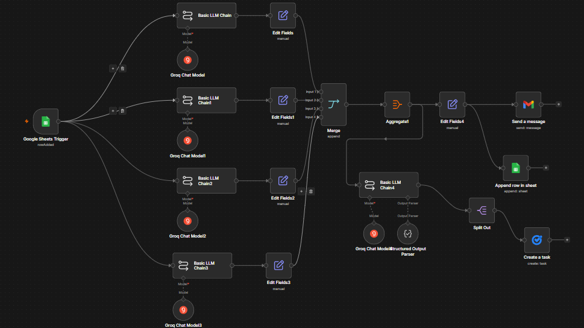
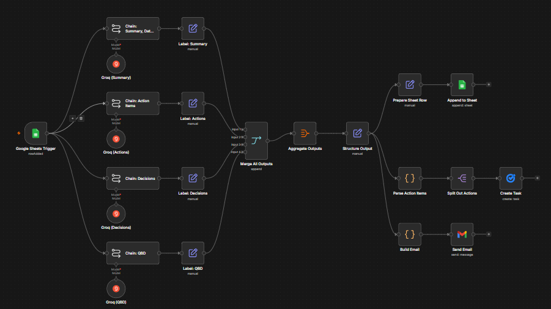
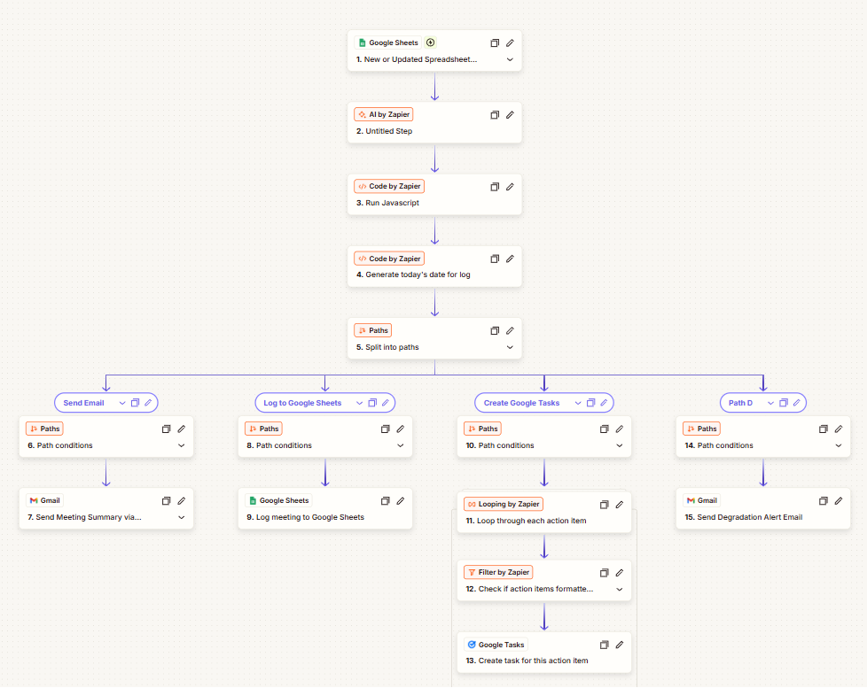

# P01: Meeting Intelligence Pipeline

I built this pipeline to take a raw meeting transcript and turn it into a full meeting record. It writes a summary and pulls out the action items, decisions, and open questions, and then it sends them to Gmail, Google Sheets, and Google Tasks in one run.

This is also the pipeline I've rebuilt the most. I built the same spec by hand in n8n, again with Claude Code, and again in Zapier, because I wanted to measure how much the build tool changes the result when the requirements stay the same.

**Manual n8n build:**

**Claude Code build (same spec):**

**Zapier Copilot build (redesigned for Zapier):**

---

## The Builds

| Folder | Platform | Build tool | What it shows |
|---|---|---|---|
| [`n8n-manual-build/`](n8n-manual-build/) | n8n | By hand | The reference build, with 4 LLM chains running in parallel and a full architecture README |
| [`claude-code-build/`](claude-code-build/) | n8n | Claude Code | The same spec, built 4x faster with no logic debugging |
| [`zapier-copilot-build/`](zapier-copilot-build/) | Zapier | Zapier Copilot | The same goal on Zapier, using 1 AI call, a 4-way Paths fan-out, and three layers of failure handling |
| [`zapier-eval-build/`](zapier-eval-build/) | Zapier | In progress | An evaluation setup with 7 test transcripts, extraction rules, and a scoring spec for an LLM judge |

## Manual n8n vs. Claude Code

I built the pipeline by hand first, which took about 8 hours, and 6 separate logic bugs came up along the way that I had to track down. Then I gave Claude Code the same spec and had it rebuild the pipeline.

| Metric | Manual n8n Build | Claude Code Build |
|--------|-----------------|-------------------|
| Runtime | 8.385 seconds | 9.316 seconds |
| Tokens per run | 3,762 | 3,194 |
| Build time | ~8 hours | ~2 hours |
| Logic debugging required | Yes (6 distinct issues) | None |

The two pipelines performed about the same, and the Claude Code build took a quarter of the time. What I found most interesting is that Claude Code got right on its own the exact things I had struggled with in the manual build.

## The Zapier Build

I didn't copy the n8n design over to Zapier. I redesigned it around how Zapier works. The n8n builds run four LLM chains in parallel and merge the results, while the Zapier build makes one extraction call and then splits the output into four Paths.

The Zapier build also handles failures, which the n8n builds don't. It checks each AI field and substitutes a default when one is missing, it skips creating tasks if the action items come back malformed, and if an AI field comes back empty it sends me an alert email instead of the recap. The full comparison is in [`zapier-copilot-build/README.md`](zapier-copilot-build/README.md).

## What's Next

The [`zapier-eval-build/`](zapier-eval-build/) folder is the next step. It has seven made-up transcripts with known correct answers, covering a clean standup, a messy quarterly planning meeting, a discovery call where nothing was decided, names with accents, unclear due dates, and side conversations that should be ignored. It also has the scoring rules for an LLM judge, so that when I change the pipeline, a drop in the scores will tell me something broke.
