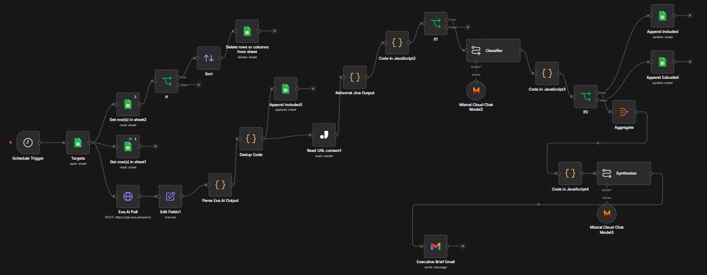
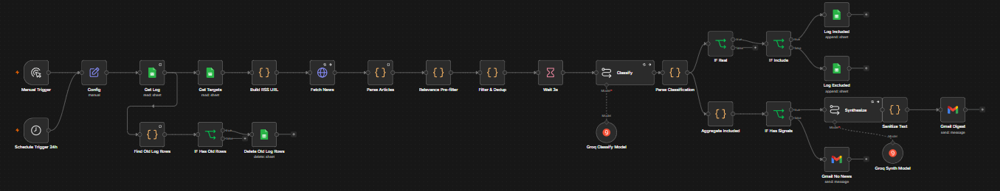

# P02: AI Competitive Intelligence Monitor

I built this workflow to keep track of 10 AI companies without reading the news myself every day. Each morning it pulls the news for those companies, filters and classifies it, and emails me a short briefing. Every article it looks at gets logged to a Google Sheet, and it checks that log on each run so the same article never gets reported twice.

There are two n8n builds of this monitor, and each one pulls its news from a different source.

**Manual build (Exa.ai + Jina):**

**Claude Code build (Google News RSS + Groq):**

---

## The Two n8n Builds

| | Manual Build | Claude Code Build |
|---|---|---|
| News source | Exa.ai semantic search | Google News RSS (free, no key) |
| Enrichment | Jina article extraction | None needed (RSS descriptions) |
| Classification | LLM signal typing | Groq `llama-3.1-8b-instant` |
| Synthesis | LLM daily briefing | Groq `llama-3.3-70b-versatile` |

I built the manual version first to prove the idea, using Exa's paid semantic search. For the Claude Code rebuild, I limited it to free APIs, so it had to get to the same result with RSS and more filtering. It runs a relevance check first, then sorts each article into one of 8 categories, and it only reports funding news when the round is $100M or more. If nothing makes it through the filters, it still sends an email saying so, so I always get one email per run.

---

## Folders

| Folder | Contents |
|---|---|
| [`n8n-manual-build/`](n8n-manual-build/) | The Exa.ai + Jina workflow JSON |
| [`claude-code-build/`](claude-code-build/) | The RSS + Groq rebuild, with the full architecture doc in its `CLAUDE.md` |
| [`make-build/`](make-build/) | A third build in Make, using Google Gemini for classification and the briefing, plus a small companion scenario that clears out old log rows |
| [`snowflake-build/`](snowflake-build/) | The data side rebuilt in Snowflake. Raw news lands in one table, a SQL step removes duplicates into a cleaned table, and Snowflake Cortex does the classification. It includes the spec and a `setup.sql` you can run |

The Claude Code build's [`CLAUDE.md`](claude-code-build/CLAUDE.md) explains the design decisions, including how I handled API rate limits, why duplicates are checked by URL across runs, why the log keeps 7 days, and why I kept duplicates within a single run on purpose.
