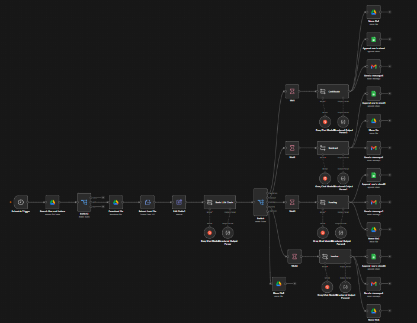

# P03: Document Processing and Classification

I built this n8n workflow to sort documents so I don't have to. When I drop a PDF into a Google Drive inbox folder, the workflow reads it, uses AI to decide what kind of document it is, pulls out the key details, and moves it to the right folder. It also logs the details to Google Sheets and emails me a summary.



---

## What It Does

When a new PDF lands in the inbox folder, the workflow:

1. Downloads the document and extracts the text
2. Uses an LLM to put the document into one of four categories
3. Moves documents it's confident about to the matching Google Drive folder
4. Sends documents that are unclear or a mix of types to a Review folder for a person to look at
5. Makes a second LLM call to pull out the fields that matter for that category
6. Logs those fields to Google Sheets
7. Sends a formatted HTML email summarizing what it found
8. Moves the file out of the inbox and into its category folder

---

## Document Categories

All of the test files I used for this workflow were made up, not real documents.

| Category | What goes here |
|---|---|
| **Funding Doc** | Investment agreements, term sheets, seed and series rounds |
| **Contract** | Service agreements, vendor MSAs, and legal contracts for services only, with no investment component |
| **Invoice** | Vendor bills, payment requests, subscription renewals |
| **Certificate** | Training credentials, professional certifications, course completions |
| **Unknown** | Mixed documents or anything that doesn't clearly fit one category. These go to the Review folder |

---

## Google Drive Folder Structure

```
Doc Processing Pipeline/
├── Inbox/                    ← Drop files here
├── Classified/
│   ├── Funding_Docs/
│   ├── Contracts/
│   ├── Invoices/
│   └── Certs/
├── Review/                   ← Unknown/ambiguous documents
└── Staging/                  ← Google Sheet lives here
```

---

## Google Sheets Logging

There's one spreadsheet with a tab for each of the four document types, and each row is one processed document.

**Funding Docs:** Timestamp | Filename | File ID | Funder | Recipient | Amount | Program | Key Terms

**Contracts:** Timestamp | Filename | File ID | Vendor | Customer | Effective Date | Expiration Date | Contract Value | Key Services | Governing Law

**Invoices:** Timestamp | Filename | File ID | Vendor | Customer | Invoice # | Invoice Date | Due Date | Amount | Line Items | Payment Status

**Certs:** Timestamp | Filename | File ID | Cert Holder | Issuer | Cert Type | Issue Date | Expiration Date | Cert #

---

## The Zapier Build

I also built this workflow in Zapier to compare the two tools on the same spec, and the experience was very different. The workflow export and my notes on what went wrong are in [`zapier-build/`](zapier-build/). The short version is that Zapier has a bigger library of app connections, but it can't export a single workflow as a file, and Copilot couldn't handle basic requests like renaming a path, so I did most of the configuration by hand.

---

## Prerequisites

- n8n Cloud account (or self-hosted n8n instance)
- Google account with Drive, Sheets, and Gmail access
- Groq API key (free tier available)

---

## Setup

### Step 1: Google Drive
Create the folder structure above. Then copy each folder's ID from its URL, because you'll need them in n8n.

```
https://drive.google.com/drive/folders/[FOLDER_ID_IS_HERE]
```

### Step 2: Google Sheets
Create a spreadsheet with four tabs named exactly:
- `Certs`
- `Contracts`
- `Funding Doc`
- `Invoices`

Add the column headers for each tab as listed in the Google Sheets Logging section above.

### Step 3: n8n Credentials
Create the following credentials in n8n:

| Credential | Used By |
|---|---|
| Groq API | All LLM nodes |
| Google Drive OAuth2 | Search, Download, Move nodes |
| Google Sheets OAuth2 | Append row nodes |
| Gmail OAuth2 | Send email nodes |

### Step 4: Import Workflow
1. Import `P03-document-processing.json` from the n8n workflow menu (⋯ → Import)
2. Update all Google Drive nodes with your folder IDs
3. Update all Google Sheets nodes with your spreadsheet ID and tab names
4. Update the Gmail node with your email address
5. Connect each credential to its nodes
6. Activate the workflow

### Step 5: Test
Upload a PDF to your Inbox folder. Within 60 seconds you should see:
- The file moved to the correct subfolder
- A new row in the matching Google Sheet tab
- A formatted HTML email in your inbox

---

## Environment Variables

Set these in your n8n instance settings or as environment variables:

```
GROQ_API_KEY=
INBOX_FOLDER_ID=
FUNDING_FOLDER_ID=
CONTRACTS_FOLDER_ID=
INVOICES_FOLDER_ID=
CERTS_FOLDER_ID=
REVIEW_FOLDER_ID=
GOOGLE_SHEETS_ID=
```

---

## File Structure

```
P03-document-processing/
├── P03-document-processing.json    ← n8n workflow (credentials scrubbed)
├── README.md                       ← Setup and human-facing instructions
├── REQUIREMENTS.md                 ← Functional and non-functional requirements
├── BUILD_PROCESS.md                ← Architecture, design decisions, lessons learned
└── zapier-build/                   ← Zapier version and lessons learned
```

---

## Built With

| Tool | What it does here |
|---|---|
| [n8n](https://n8n.io) | Runs the workflow |
| [Groq](https://console.groq.com) | Runs the LLM calls |
| [LLaMA 3.1 8b Instant](https://groq.com) | Classifies the document |
| [LLaMA 3.3 70b Versatile](https://groq.com) | Extracts the metadata |
| Google Drive | Stores and routes the documents |
| Google Sheets | Keeps the classification log |
| Gmail | Sends the summary emails |

---

## Part of a Larger Portfolio

This is the third in a series of n8n projects I built to work through real design problems, like running branches in parallel, carrying an ID through every step, picking a smaller or larger model depending on the task, and getting structured output from an LLM.

| # | Project | Status |
|---|---|---|
| 1 | Meeting Intelligence Pipeline | ✅ Complete |
| 2 | Competitive Intelligence Monitor | ✅ Complete |
| 3 | Document Processing & Routing | ✅ Complete |
| 4 | AI Governance & Audit Trail | ✅ Complete |
| 5 | Employee Onboarding Orchestrator | ✅ Complete |
| 6 | Lead Generation & Enrichment | ✅ Complete |
| 7 | Customer Trigger Messaging | ✅ Complete |
