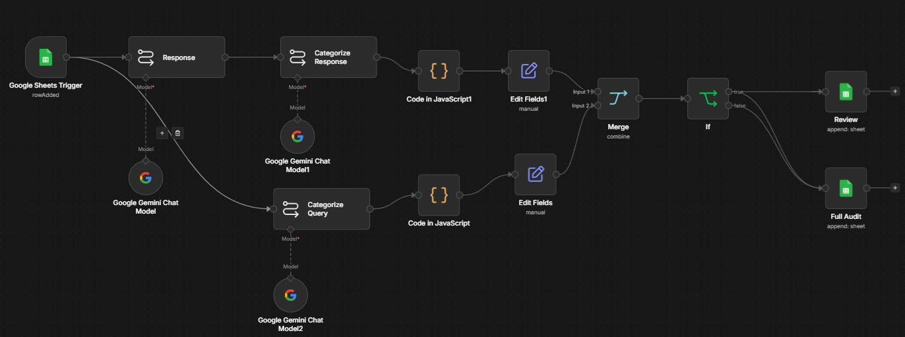

# P04: AI Governance Tool

I built this n8n workflow to understand what it takes to put guardrails around an AI tool. It reads questions from a Google Sheet, has an LLM answer each one, and then checks both the question and the answer for sensitive information. Every result gets written to an audit log, and anything sensitive or unclear goes to a review sheet so a person can look at it.

---

## What It Does

1. Reads every row from the **Questions** sheet (columns: `User ID`, `Query`)
2. Has Groq (`qwen/qwen3-32b`) write a plain-text answer for each question
3. Classifies the **question** and the **answer** separately, at the same time, using two labels:
   - **Classification:** `SENSITIVE` | `STANDARD` | `UNCERTAIN`
   - **Domain:** `PII` | `FINANCIALS` | `STRATEGIC` | `CREDENTIALS` | `LEGAL` | `MEDICAL` | `HR` | `NAMED_INDIVIDUAL` | `NONE`
4. Writes every result to the **Audit Log Claude** sheet
5. Sends the item to the **Review Claude** sheet if either the question or the answer was labeled `SENSITIVE` or `UNCERTAIN`

I classify the question and the answer separately because a harmless question can still get an answer that exposes something sensitive, and checking only the question would miss that.

---

## The Zapier Build

I rebuilt this pipeline in Zapier as a 10-step Zap, with Copilot doing the initial wiring. It follows the same idea, and it fails closed: if either classification comes back invalid, a Code step treats it as `SENSITIVE` so it goes to review instead of slipping through. The export and my notes on where I overrode Copilot's defaults are in [`zapier-copilot-build/`](zapier-copilot-build/).

---

## Prerequisites

- n8n instance (cloud or self-hosted)
- Google Sheets OAuth2 credential configured in n8n
- Groq API key configured as a Bearer Auth credential in n8n

---

## Google Sheets Setup

The workflow points at your spreadsheet (set `YOUR_GOOGLE_SHEET_ID` when you import it). Create or check these sheets:

| Sheet name | Required columns |
|---|---|
| Questions | `User ID`, `Query` |
| Audit Log Claude | See REQUIREMENTS.md for output column details |
| Review Claude | See REQUIREMENTS.md for output column details |

---

## Import Steps

1. In n8n, go to **Workflows → Import** and upload `P04-ai-governance.json`
2. Open each HTTP Request node and select your Groq Bearer Auth credential again
3. Check that the Google Sheets nodes are using your **Google Sheets OAuth2 API** credential
4. Open the **Route to Review** IF node and confirm all four conditions show as expressions, not static values. The Known Issues section of BUILD_PROCESS.md explains why
5. Save and run it with the Manual Trigger

---

## Credentials

| Node | Credential type | Expected name |
|---|---|---|
| Read Questions | Google Sheets OAuth2 | `Google Sheets OAuth2 API` |
| Append Audit Log | Google Sheets OAuth2 | `Google Sheets OAuth2 API` |
| Append Review | Google Sheets OAuth2 | `Google Sheets OAuth2 API` |
| Generate Response | HTTP Bearer Auth | your Groq Bearer Auth credential |
| Classify Query | HTTP Bearer Auth | your Groq Bearer Auth credential |
| Classify Response | HTTP Bearer Auth | your Groq Bearer Auth credential |

---

## Files

| File | Description |
|---|---|
| `P04-ai-governance.json` | The n8n workflow export to import into n8n |
| `REQUIREMENTS.md` | Goals, scope, functional and non-functional requirements, and acceptance criteria |
| `BUILD_PROCESS.md` | Architecture, design decisions, node table, technology choices, and known issues |
| `LESSONS_LEARNED.md` | Build notes and gotchas for future n8n and Groq workflows |
| `validate_workflow.py` | The validation script I used during development |
| `zapier-copilot-build/` | The Zapier version, with its export and lessons learned |
| `images/Proj4_Governance.png` | Manual build canvas |
| `images/Proj4_Governance_ClaudeCode.png` | Claude Code build canvas |
