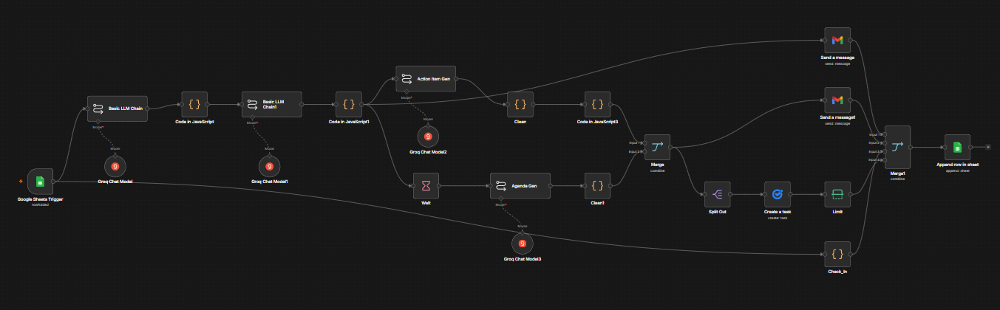
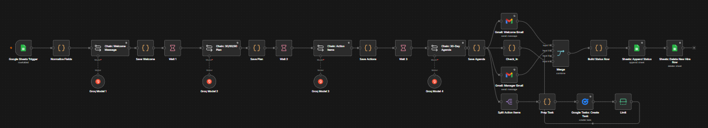

# P05: Employee Onboarding Orchestrator

I built this n8n workflow to run a new hire's whole onboarding sequence from one trigger. When I add a row to a Google Sheet, the workflow writes a personalized welcome email and a 30-60-90 day plan for the new hire. For the manager, it writes a list of action items and a first-week agenda, and it creates one Google Task per action item. It also works out the date for a 30-day check-in and logs the status. All of the writing is done by Groq (`llama-3.3-70b-versatile`), and each piece is personalized to the hire.

**Manual n8n build:**

**Claude Code build (same spec):**

---

## Folders

| Folder | Contents |
|---|---|
| [`n8n-manual-build/`](n8n-manual-build/) | The hand-built workflow JSON and the full README, with the architecture, node table, design decisions, and setup |
| [`claude-code-build/`](claude-code-build/) | The Claude Code rebuild of the same spec |
| [`zapier-build/`](zapier-build/) | A 9-step Zapier version and my notes on what I learned building it |

The full detail is in [`n8n-manual-build/README.md`](n8n-manual-build/README.md), and the design decisions section is the part I'd read first. In short, I treat anything the LLM sends back as messy until it's been cleaned up. I have it separate list items with `---` instead of new lines, because new lines weren't reliable for splitting the list. And after the task branch creates one Google Task per action item, I use a Limit node to collapse those results back down to one item, so the final log entry gets written once instead of once per task.

In the Zapier build, I went a different way and used one AI call that returns all four pieces at once, the welcome email, the 30-60-90 plan, the manager action items, and the agenda. Because both emails come from the same generation, the new hire's email and the manager's email stay consistent with each other.
