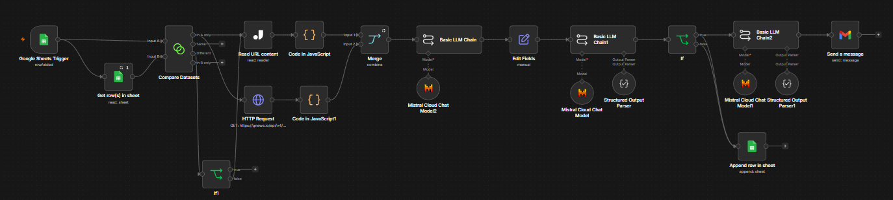
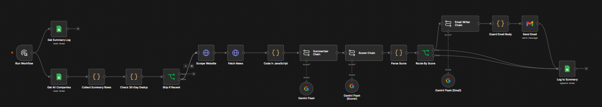
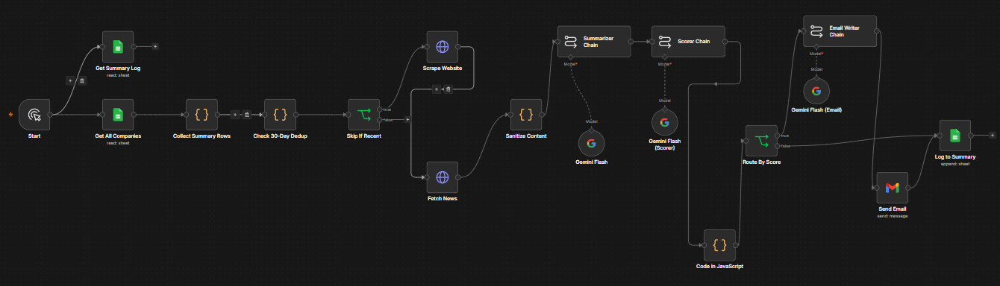

# P06: Lead Generation and Enrichment Pipeline

I built this n8n workflow to automate the research and outreach that normally goes into finding sales leads. It starts from a Google Sheet of target companies. For each new company, it reads the company's website with Jina Reader, pulls recent news, and has an LLM summarize what it found. Then it scores the company from 1 to 10 against a defined customer profile and only sends a personalized email if the score is high enough. Everything gets logged, and any company contacted in the last 30 days is skipped.

I also used this project to compare three build tools on one spec. I built it by hand in n8n, then had Claude Code and OpenCode each build it from the same requirements document.

**Manual n8n build:**

**Claude Code build (R2):**

**OpenCode build:**

---

## The Three-Way Comparison

| Build | Tool | Result |
|---|---|---|
| [`n8n-manual-build/`](n8n-manual-build/) | Built by hand in n8n | The baseline |
| [`claude-code-r2/`](claude-code-r2/) | Claude Code, working from a written spec | Built 2.4x faster than the manual build |
| [`opencode-build/`](opencode-build/) | OpenCode (VS Code extension, using OpenRouter) | Generated the workflow JSON, but I had to debug it and rewire it after importing |

All three builds worked from the same requirements document, and I measured each one. I wasn't trying to pick a winner. I wanted to see what each tool gets right by itself and where I still have to step in.

I later built a fourth version in Zapier, with Copilot doing the initial wiring. It runs every morning, scores each company, and only emails the ones that score 7 or higher. That build is in [`zapier-copilot-build/`](zapier-copilot-build/).

---

## Key Files

| File | Contents |
|---|---|
| [`claude-code-r2/P6_Requirements.md`](claude-code-r2/P6_Requirements.md) | The requirements document all three builds worked from, with the scope, functional and non-functional requirements, and acceptance criteria |
| [`claude-code-r2/BUILD_PROCESS.md`](claude-code-r2/BUILD_PROCESS.md) | The build spec, with the architecture, node tables, technology choices, scoring prompt, and JSON output rules |
| [`claude-code-r2/CLAUDE.md`](claude-code-r2/CLAUDE.md) | The build rules I gave Claude Code, covering what to build, the constraints, the phase gates, and pointers to the two docs above |
