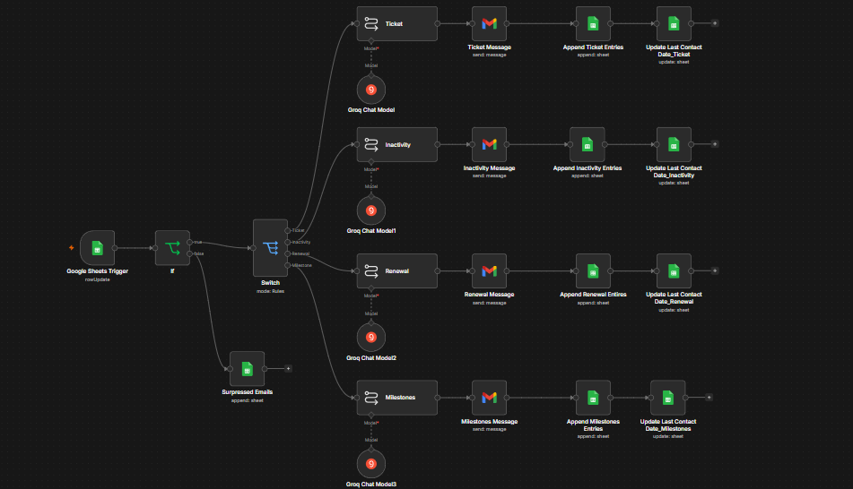
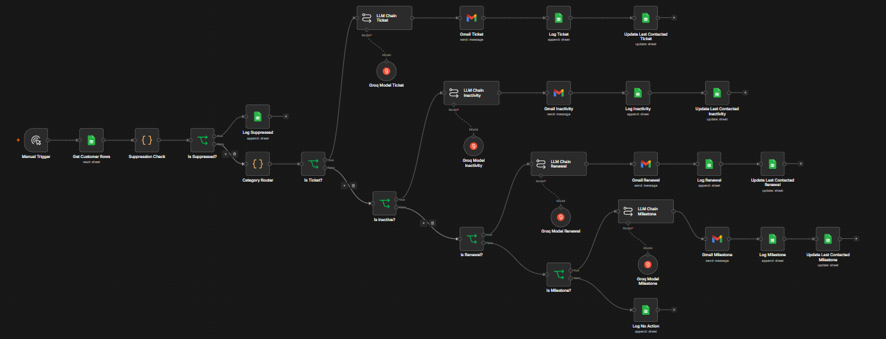

# P07: Customer Trigger Messaging Pipeline

I built this n8n workflow to reach out to customers at the right moments without anyone having to watch for those moments. It checks a customer database for four situations: a support ticket closed in the last 24 hours, 14 or more days without activity, a renewal coming up within 30 days, or a milestone the customer just reached. When one of those comes up, it sends an AI-written email, and each situation has its own prompt and its own email. Nobody gets contacted more than once in 7 days, and every email it sends, or decides not to send, is written to an activity log that only gets added to.

**Manual n8n build:**

**Claude Code build (same spec):**

---

## Folders

| Folder | Contents |
|---|---|
| [`n8n-manual-build/`](n8n-manual-build/) | The hand-built workflow JSON and the full README, with the routing logic, the prompt for each situation, and the sheet layouts |
| [`claude-code-build/`](claude-code-build/) | The Claude Code rebuild, with my build notes in `LESSONS_LEARNED.md` |
| [`zapier-build/`](zapier-build/) | The Zapier version and my notes on building it |
| [`snowflake-build/`](snowflake-build/) | The data side rebuilt in Snowflake, with a customer table, an activity log table, and a SQL view that handles the 7-day rule and decides which message wins. It includes the spec and a `setup.sql` you can run |

The full detail is in [`n8n-manual-build/README.md`](n8n-manual-build/README.md). The design choice that matters most is that the 7-day rule is a plain IF node and not something the LLM decides, so the model can never talk the pipeline into contacting a customer too often.

When a customer hits more than one situation on the same day, the pipeline follows a priority order. Instead of three emails, they get one, about the most urgent thing, in this order: ticket, then inactivity, then renewal, then milestone. Anything lower on the list can still go out on a later day if it still applies.
